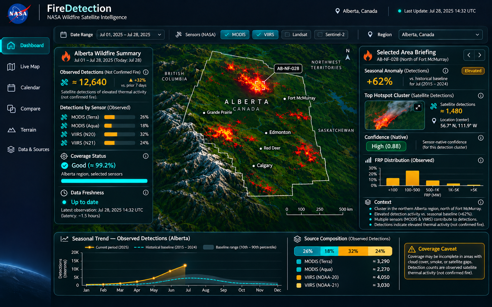
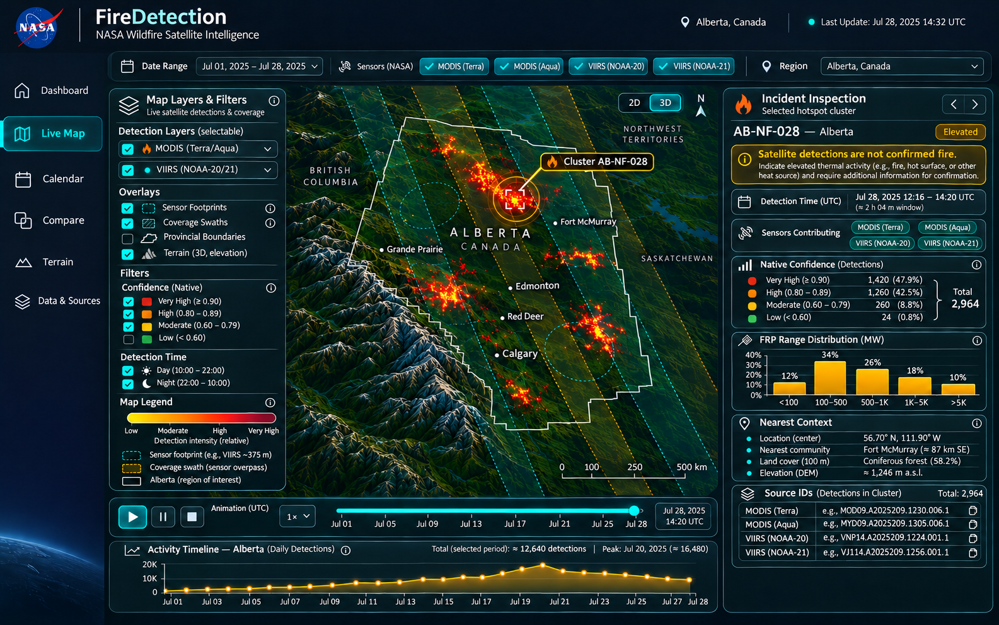
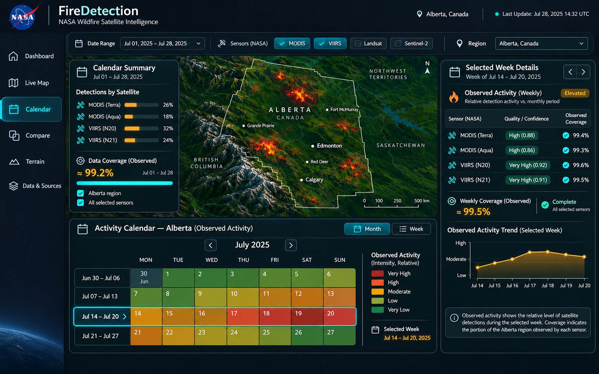
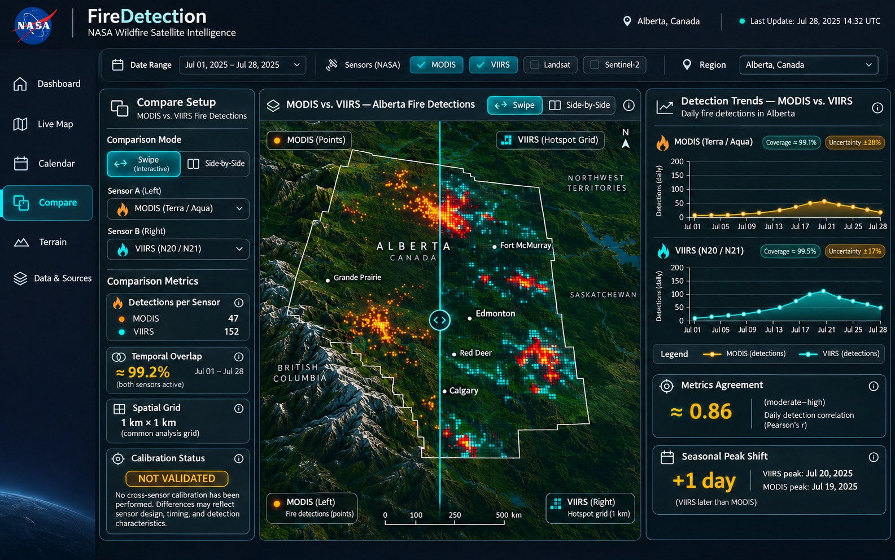
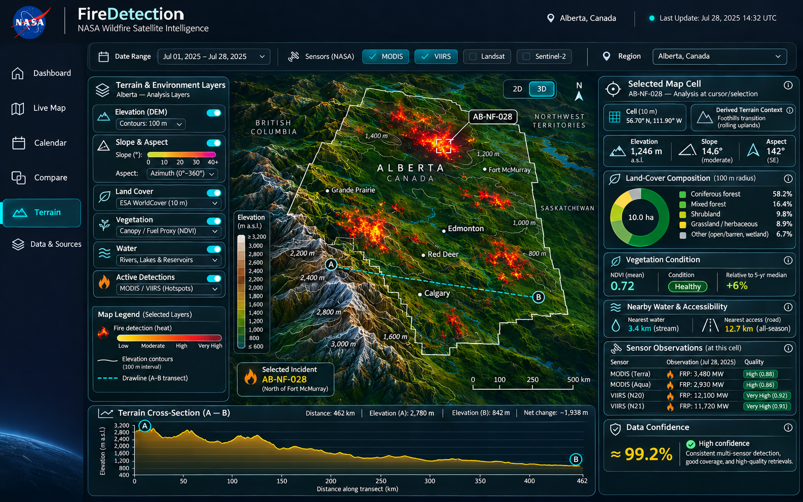
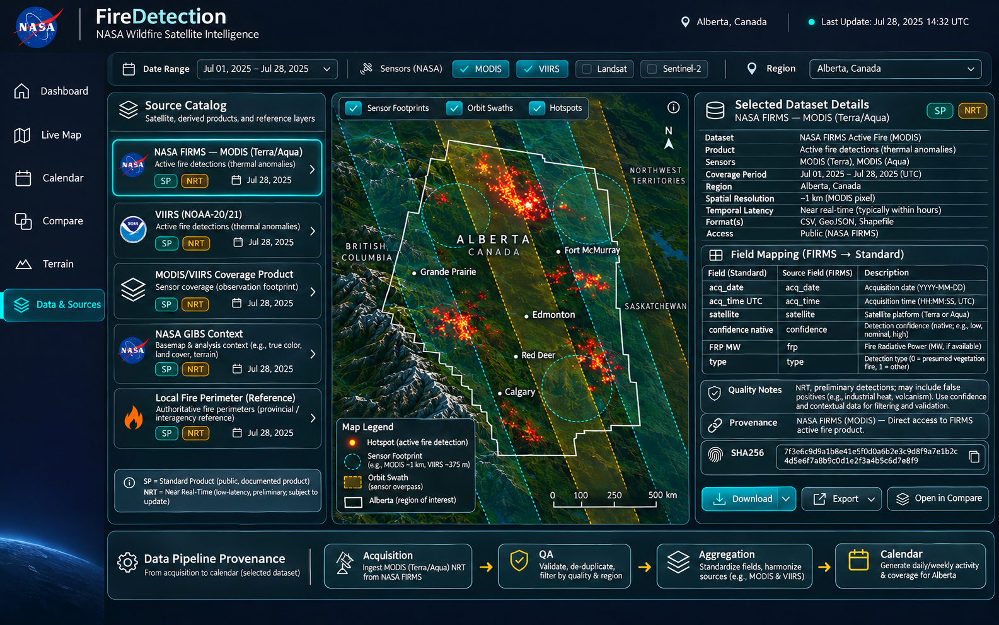
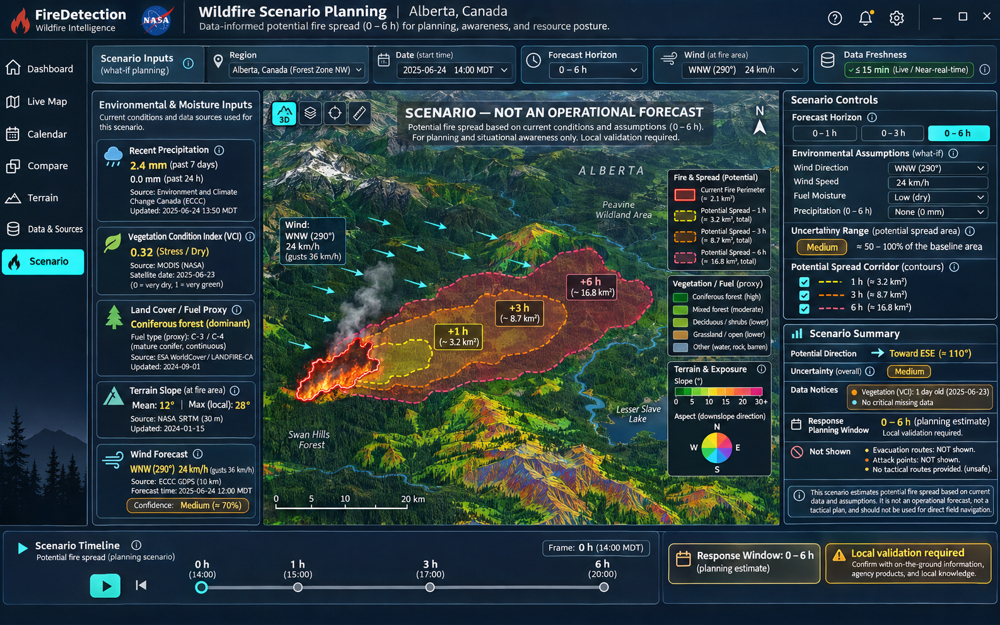
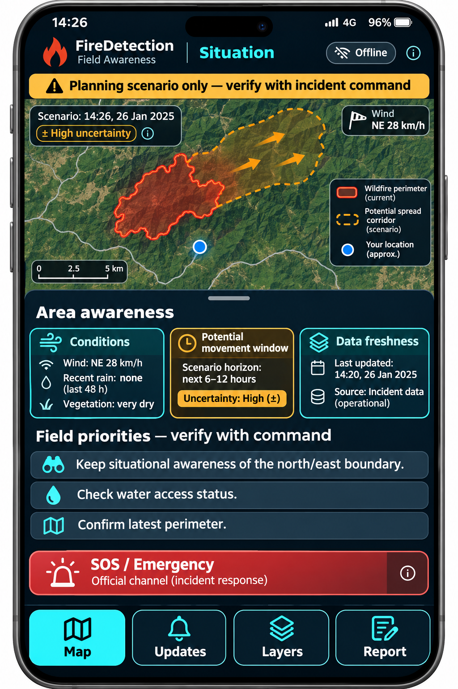

# FireDetection — plan produit, parcours utilisateur et onglets

> **État : proposition de conception.** Les six images dans [`ui/`](ui/) sont des maquettes générées pour explorer la composition. Les lieux, dates, détections, couvertures, anomalies, FRP et chiffres affichés sont fictifs et ne constituent pas des résultats calculés. Les données de l’interface finale devront venir du pipeline FireDetection et conserver leur provenance.

## 1. Vision produit

FireDetection est une plateforme cartographique qui aide un gestionnaire du territoire, un analyste feu ou un scientifique à répondre rapidement à trois questions :

1. **Où et quand les capteurs ont-ils détecté une activité thermique ?**
2. **Cette activité est-elle différente de ce qui a été observé dans une période comparable ?**
3. **Quelles données, limites et sources soutiennent cette lecture ?**

Le produit présente une **activité détectée par satellite**, pas un inventaire exhaustif des incendies. Il ne prétend pas confirmer un feu, calculer des hectares brûlés à partir de hotspots, prévoir la propagation, émettre une alerte de sécurité ou donner des consignes d’intervention.

### Promesse utilisateur

> « En quelques secondes, je vois où l’activité détectée se concentre, je peux l’explorer sur la carte, comprendre son évolution, comparer les capteurs et vérifier la source sans devoir lire un rapport technique. »

## 2. Principes d’expérience

- **Carte au centre, toujours.** Le fond cartographique occupe la majorité de la largeur et reste le point de repère de tous les onglets.
- **Un écran = une tâche.** Chaque onglet répond à une question principale; les détails avancés apparaissent dans des panneaux contextuels, tiroirs ou infobulles.
- **Pas de scroll vertical sur desktop.** L’en-tête global, la barre latérale, la carte et les panneaux tiennent dans la hauteur du viewport. Le contenu secondaire défile à l’intérieur de son panneau seulement. Sur mobile, les panneaux deviennent des tiroirs et le scroll vertical devient acceptable.
- **Hiérarchie simple.** En haut : zone, période et sources. Au centre : carte. À gauche : couches/filtres ou synthèse. À droite : analyse de l’élément sélectionné. En bas : chronologie ou graphique court lié à la carte.
- **Information progressive.** Les unités, la définition d’une métrique et la provenance sont à un clic; elles ne surchargent pas l’écran initial.
- **Toujours distinguer les inconnues.** « Inconnu », « pas disponible », « aucune détection renvoyée » et « observation valide sans détection » ne sont pas des synonymes.
- **Une seule plateforme d’analyse.** Les sources originales gardent leur identité, mais les données normalisées, agrégats, séries, provenance et analyses sont consultables dans une seule expérience intégrée. « Centralisé dans l’application » ne signifie pas que les mesures des capteurs deviennent physiquement identiques.
- **Maquettes sans fausses preuves.** Toutes les valeurs provisoires sont identifiées comme exemples; l’application réelle masque un indicateur tant que sa source ou son calcul n’est pas disponible.

## 3. Structure de navigation

La barre latérale proposée conserve le même thème et les mêmes positions dans chaque vue :

| Ordre | Onglet | Question utilisateur | Écran principal |
|---:|---|---|---|
| 1 | **Dashboard** | Que se passe-t-il dans ma zone en ce moment ou sur la période choisie ? | Carte + synthèse + anomalie saisonnière + courbe de référence |
| 2 | **Carte live** | Où sont les détections, quelles couches et filtres m’aident à les inspecter ? | Carte interactive + filtres + fiche de sélection + animation temporelle |
| 3 | **Calendrier** | Quand l’activité détectée est-elle concentrée ou inhabituelle ? | Calendrier d’activité et référence par capteur, lié à la carte |
| 4 | **Comparer** | En quoi MODIS et VIIRS diffèrent-ils sur des périodes comparables ? | Carte swipe/side-by-side + séries séparées + statut de validation |
| 5 | **Terrain** | Quel contexte physique et environnemental entoure une cellule ou un groupe ? | Relief 3D + couches auxiliaires + profil et fiche contextuelle |
| 6 | **Données & sources** | D’où vient ce que je vois, comment a-t-il été traité et que puis-je exporter ? | Catalogue de données + provenance + champ mapping + pipeline |
| 7 | **Scénario** | Comment vent, pluie, terrain et combustibles influencent-ils une propagation hypothétique ? | Simulation « what-if » avec entrées datées, horizon et incertitude |

**Navigation globale persistante :** logo/nom produit en haut de la barre latérale; icône et libellé pour chaque item; surlignage cyan de l’onglet actif; raccourci clavier optionnel et étiquettes accessibles. La barre est repliable en icônes, mais ne disparaît pas lors du changement d’onglet.

### En-tête commun

Chaque écran garde le même bandeau supérieur compact :

- zone d’intérêt avec recherche, sélection d’une région enregistrée et dessin d’un polygone;
- dates de début/fin, raccourcis 7 j / 30 j / saison / période personnalisée;
- sélecteurs des plateformes réellement disponibles (MODIS Terra, MODIS Aqua, VIIRS NOAA-20, VIIRS NOAA-21; autres sources seulement si implémentées et clairement séparées);
- mode de traitement SP/NRT avec date de fraîcheur;
- bouton « Réinitialiser les filtres »;
- menu d’export et aide « comprendre ces données ».

Les sélecteurs globaux persistent entre les onglets. Si une source n’est pas disponible pour une plage, l’interface la désactive et explique pourquoi, sans afficher une série vide comme zéro activité.

## 4. Parcours utilisateur complet

### Parcours A — première ouverture

1. L’utilisateur arrive sur Dashboard avec une zone exemple et une période cohérentes, explicitement marquées **Démo** tant que son choix réel n’est pas fait.
2. Un message en une ligne explique la carte : « Points = anomalies thermiques détectées; ils ne confirment pas un incendie. »
3. La carte montre une seule vue lisible : agrégation par intensité relative avec légende, pas des milliers de marqueurs superposés.
4. L’utilisateur choisit sa région ou dessine son AOI. La période réellement disponible est indiquée avant validation.
5. Le Dashboard charge les statistiques disponibles, la chronologie et les limitations de couverture. Les éléments non calculables restent affichés en état « Donnée requise » plutôt qu’avec une valeur inventée.

### Parcours B — examiner un pic

1. Cliquer une semaine dans la courbe ou une cellule du calendrier.
2. La carte zoome sur l’AOI et sélectionne les détections correspondant au filtre temporel.
3. Le panneau de droite décrit les détections : plateformes contributrices, heures UTC, confiance native, distribution FRP disponible, nombre de sources et état de couverture.
4. Cliquer une observation ouvre ses attributs et son origine de fichier/ligne.
5. Passer dans Compare ou Terrain garde la sélection et la zone afin que l’utilisateur ne recommence pas son exploration.

### Parcours C — comprendre une anomalie

1. L’application compare une métrique déclarée à sa référence saisonnière.
2. Le panneau présente période cible, référence, quantiles ou bande d’incertitude, années disponibles, capteurs utilisés et couverture.
3. Un badge indique **descriptif**, **évalué**, **insuffisant** ou **hors domaine**.
4. Les détails d’analyse révèlent les filtres et permettent de comparer les capteurs individuellement.
5. L’utilisateur exporte une fiche avec paramètres et limites.

### Parcours D — comparer les capteurs

1. Choisir les plateformes, la même zone, les périodes réellement en recouvrement et un pas temporel commun.
2. Afficher les couches brutes séparément sur une carte avec curseur de comparaison ou côte-à-côte.
3. Comparer les calendriers par capteur et voir la composition de constellation.
4. Consulter une grille commune à titre d’agrégat, sans appeler cela « calibration ».
5. Si une calibration a été calculée et testée, voir ses performances sur le jeu réservé et son domaine. Sinon, le bouton reste désactivé avec l’explication nécessaire.

### Parcours E — produire une analyse partageable

1. Cliquer « Exporter l’analyse » depuis tout onglet.
2. Choisir résumé PDF/HTML, agrégats CSV/JSON ou paquet reproductible.
3. Inclure zone/polygone, dates UTC, plateformes, versions, filtres, méthode, statut de couverture, références, hash des fichiers, date de calcul, limites et citations.
4. Confirmer avant d’inclure des lignes de détection détaillées dans un fichier volumineux.

## 5. Plan détaillé par onglet

### 5.1 Dashboard — comprendre le tableau général

**Composition écran :** carte centrale dominante; bandeau global en haut; panneau gauche compact « Synthèse de la zone »; panneau droit « Point saillant / anomalie »; bande basse pour la tendance saisonnière, la composition des sources et l’état des données. La carte et le graphique partagent le même filtre de période.

**Fonctions :**

- synthèse de la période sélectionnée : nombre de détections retournées, nombre de cellules ayant au moins une détection, variation observée par rapport à une référence comparable;
- répartition des détections par plateforme (pas de pourcentage d’un total fusionné si les populations et couvertures ne sont pas comparables);
- date/heure de la dernière acquisition et latence déclarée de chaque branche;
- mini-courbe activité courante versus médiane/plage historique, séparée par plateforme si non harmonisée;
- badge « référence suffisante/insuffisante » et état des inconnues de couverture;
- carte des concentrations de détection, clusters décrits comme clusters de pixels détectés;
- liste des zones ou clusters les plus actifs, triable par activité détectée, heure ou FRP native;
- raccourcis vers Calendrier, Comparer et Sources qui conservent l’AOI et la période.

**Ne pas afficher comme faits sans sources adaptées :** « feux actifs », « hectares brûlés », « croissance du feu », « couverture 99 % », « risque de propagation ». Présenter plutôt « détections renvoyées », « cellules avec détection », « observations exploitables connues : inconnues ».

Maquette : 

### 5.2 Carte live — explorer les observations

**Composition écran :** carte au centre avec relief discret ou mode 2D/3D; panneau gauche pour couches et filtres; panneau droit pour inspecter la sélection; bandeau inférieur temporel avec lecteur/pause et courbe courte.

**Fonctions :**

- afficher/masquer chaque plateforme sans fusion visuelle;
- basculer entre points individuels et densité/heatmap; changer le rayon ou la grille explicitement;
- filtrer avec les catégories natives de confiance; l’UI doit respecter les sémantiques propres aux instruments et éviter une échelle commune trompeuse;
- filtres jour/nuit, période et type d’anomalie seulement si ces champs existent dans le produit;
- time slider/animation UTC avec jour ou semaine, saut aux dates disponibles et indication des lacunes;
- inspection au clic : lat/lon, date et heure UTC, satellite, plateforme, confiance native, FRP si fournie, géométrie/scan-track si disponible, source et identifiant;
- sélection de plusieurs observations pour résumer des attributs, sans appeler automatiquement le groupe un incendie;
- panneaux de couverture et empreintes de passage uniquement si des données de couverture distinctes sont intégrées.

**Contrôles cartographiques :** zoom, orientation nord, échelle, recherche de lieu, reset vue, sélection/dessin AOI. Les couches relief, fond satellite ou périmètres externes ont une légende et une attribution.

Maquette : 

### 5.3 Calendrier — repérer les périodes

**Composition écran :** carte plus petite mais toujours visible en haut/au centre; calendrier jour/semaine/mois dans la zone basse; panneau droit pour la période sélectionnée; barre gauche résumant les séries capteur et états de couverture.

**Fonctions :**

- vues mensuelle, hebdomadaire et saisonnière; navigation au clavier et sélection de semaine;
- intensité par métrique explicitement choisie (détections, cellules détectées, FRP quantiles) avec légende fixe;
- facettes par capteur/platforme; une vue agrégée ne devient disponible qu’avec méthode/domaine indiqué;
- référence saisonnière (médiane et quantiles) avec effectif d’années disponibles;
- annotation des transitions de constellation, produit/collection et ruptures connues;
- période sélectionnée synchronisée à la carte, série temporelle, table source;
- distinguer périodes sans détection, périodes hors données et périodes de couverture inconnue;
- bouton « pourquoi cette semaine est marquée ? » décrivant le seuil ou la règle utilisée.

**Important :** une cellule colorée est un niveau d’activité calculé ou relatif, et non un niveau de danger. Les labels « élevé » doivent indiquer la métrique et la population de référence.

Maquette : 

### 5.4 Comparer — mesurer les différences sans les cacher

**Composition écran :** carte centrale swipe ou côte-à-côte, panneau de configuration à gauche, analyses et graphiques à droite. Aucun « score de concordance » de démonstration si le pipeline ne l’a pas calculé.

**Fonctions :**

- choisir Sensor A/B parmi plateformes disponibles et mode comparaison;
- verrouiller AOI, dates, filtres et période commune;
- afficher les deux sources indépendamment et une grille commune paramétrée;
- série temporelle superposée avec unités et couverture; option facettes si les échelles divergent;
- métriques descriptives calculées : différences de compte, ratios dans les périodes éligibles, MAE/biais/Jaccard si le protocole les définit;
- carte de différence seulement si deux agrégats définis sur les mêmes supports;
- « Calibration » montrant état non évalué, rejeté, indéterminé ou validé; afficher version, train/test, métrique, incertitude et domaine de validité;
- panneau « interprétation » séparant différence attendue de résolution/sensibilité et changement potentiellement temporel;
- export de configuration et résultat.

**Règles :** la proximité de deux points n’est pas preuve d’identité; le nombre de points VIIRS supérieur n’est pas preuve d’une hausse du nombre d’incendies; une corrélation seule ne valide pas une calibration.

Maquette : 

### 5.5 Terrain — expliquer le contexte autour d’une sélection

**Composition écran :** terrain 3D central avec relief et heatmap sélectionnable; panneau gauche de couches; panneau droit d’élément/cellule; coupe topographique basse liée à un transect dessiné.

**Fonctions et sources potentielles :**

- modèle numérique d’élévation (DEM) : altitude, pente, orientation, ombrage et coupe, si résolution/zone/attribution sont connues;
- couverture du sol : catégories autour de la cellule, part de forêt/herbacé/eau/urbain avec date et légende;
- végétation : NDVI/EVI ou proxy disponible, en affichant période d’image et nuages; ne pas présenter NDVI comme humidité combustible;
- météo : température, précipitation, vent, humidité seulement si source, unité, temporalité et interpolation sont documentées;
- hydrographie, routes, zones protégées ou limites administratives pour le contexte, avec attribution et date;
- observations de feux superposées par capteur et date UTC;
- profil d’altitude du transect, pente locale et changement d’élévation;
- fiche de composition environnementale dans un rayon choisi, avec possibilité de changer le rayon et de voir les données manquantes.

**Rôle scientifique :** aider à contextualiser une détection. Ne pas inférer que la pente, la végétation ou la proximité d’une route a causé l’observation. Ces facteurs ne sont pas prédictifs sans modèle et validation appropriés.

**Priorité MVP :** MNT/relief + pente + occupation du sol, si les couches sont facilement disponibles et correctement licenciées. Ajouter végétation et météo comme phase suivante. Aucun nombre d’élévation, pourcentage de couverture du sol ou indice ne doit être inventé dans l’application réelle.

Maquette : 

### 5.6 Données & sources — provenance et confiance

**Composition écran :** catalogue gauche; carte centrale montrant AOI et contexte des données sélectionnées; panneau droit avec métadonnées, mapping de colonnes, qualité et téléchargement; bande basse décrivant les étapes du pipeline.

**Fonctions :**

- catalogue de sources primaires FIRMS MODIS/VIIRS, produits couverture, contexte GIBS, MNT/land cover et références locales;
- badges SP/NRT, collection, plateforme, date de dernière acquisition et intervalle couvert;
- table de correspondance champs natifs → modèle interne, unités et champs absents;
- visualisation des valeurs manquantes, exclusions par règle et distributions de confiance/FRP;
- manifeste fichier, URL de provenance sans secret, taille, SHA-256, format et horodatage UTC;
- notes de qualité propres à produit/version et liens vers guides NASA;
- état « source chargée », « partielle », « indisponible », « échec », jamais confondus;
- statut pipeline Acquisition → validation QA → normalisation → agrégation → référence → affichage;
- téléchargement brut lorsque les conditions d’accès/licence le permettent, exports analytiques et citations.

Maquette : 

### 5.7 Scénario — explorer une propagation hypothétique

**Objectif :** permettre un exercice « what-if » montrant comment le vent, la pente, les combustibles, l’humidité et la météo peuvent influencer une enveloppe simulée. Cette vue n’émet ni routes, ni cibles, ni consignes tactiques et ne remplace pas les outils du centre de commandement.

**Composition :** carte 3D centrale; panneau gauche de données et fraîcheur; panneau droit d’hypothèses, horizon et incertitude; barre temporelle 0/1/3/6 h. Bannière persistante : **SCÉNARIO — PAS UNE PRÉVISION OPÉRATIONNELLE**.

**Entrées à afficher avec source, unité, horodatage et qualité :**

- périmètre initial provenant d’une carte d’incident ou d’un polygone édité et confirmé par l’utilisateur;
- vent : direction, vitesse, rafales, validité, résolution et âge de la prévision;
- pluie : cumul historique et précipitation prévue, fenêtre et source;
- sécheresse/humidité : indices issus d’une source et méthode documentées; la pluie seule n’établit pas l’humidité des combustibles;
- végétation : NDVI/EVI avec date d’image et couverture nuageuse; un indice spectral n’est pas une mesure directe de combustible mort;
- combustible : classe ou modèle documenté, sans inférence certaine depuis le seul land-cover;
- relief : DEM, pente, aspect, résolution et date;
- eau, routes, urbain et coupe-feu seulement avec géométrie et actualité connues.

**Fonctions :** modifier un paramètre à la fois; comparer deux scénarios; animer les pas temporels; afficher un corridor/enveloppe et l’incertitude si le modèle les calcule réellement; confronter ultérieurement simulation et observation sur des périodes distinctes; marquer les données manquantes/périmées; exporter entrées, version du modèle, paramètres et provenance.

Les hotspots MODIS/VIIRS ne donnent pas un front continu ni un périmètre courant. Sans un périmètre initial daté, des combustibles, une humidité adaptée et un moteur validé, la simulation doit rester indisponible et expliquer les entrées manquantes. Le « délai disponible » n’est pas une durée de sécurité : afficher un horizon de scénario, ou une fenêtre de planification estimative seulement si elle est évaluée et validée localement. Ne pas afficher routes d’attaque, points à attaquer, emplacement d’équipe, repli ou évacuation automatisés; le commandement local conserve l’autorité opérationnelle.

États possibles : `scenario_only`, `inputs_incomplete`, `stale_inputs`, `model_unvalidated`, `validated_for_scope`, `out_of_scope`.

Maquette : 

### 5.8 Vue mobile — situation terrain

Compagnon de consultation pour équipes terrain, pas une application de dispatch ou de commandement. Le téléphone doit rester lisible d’un coup d’œil et fonctionner avec un réseau instable.

**Écran Situation :** carte 2D haute avec localisation après permission, périmètre confirmé si disponible, détections satellite horodatées et corridor hypothétique distinct; bandeau « scénario à vérifier avec le commandement »; statut fraîcheur/hors ligne; cartes compactes vent/pluie/végétation/horizon/incertitude; section **À vérifier avec le commandement** (dernière limite, accès à l’eau, mise à jour secteur); bouton urgence branché aux canaux officiels configurés, sans numéro inventé; navigation basse Carte, Mises à jour, Couches, Rapport.

**Fonctions mobiles :** paquet de zone préchargé avec date; avertissement persistant de données périmées hors connexion; couches avec attribution/fraîcheur; rapport terrain horodaté et attribué à son auteur, marqué non vérifié jusqu’à validation; synchronisation après reconnexion; gros contrôles contrastés, mode gants/soleil, faible consommation et possibilité de masquer la position dans les exports selon la politique locale.

L’application ne recommande pas quel point attaquer, quelle route prendre, où positionner une équipe ou quand évacuer. Elle peut montrer une information à vérifier et sa source; les priorités viennent du plan d’incident et des responsables habilités.

Maquette : 

## 6. Composants transversaux

### Carte intégrée

- Carte interactive 2D comme comportement par défaut pour la rapidité et l’accessibilité; relief 3D activable.
- Tuiles de fond séparées de la couche analytique; l’utilisateur sait ce qui est une image de fond et ce qui est une donnée calculée.
- Heatmap de détections, points par capteur, grille d’agrégation et périmètres validés comme couches distinctes.
- Légende réactive qui nomme la métrique, période, capteur, plage et unité.
- Synchronisation sélection temporelle ↔ carte ↔ panneau ↔ graphiques.
- Panneau flottant translucide mais contraste WCAG; pas d’élément masquant la légende, nord ou contrôles.
- Le 3D ne doit pas déformer l’interprétation spatiale; bouton « Réinitialiser la vue 2D » toujours disponible.

### Graphiques

- Tendance avec médiane de référence et bande quantile si assez d’années;
- petites courbes par capteur pour comparer sans surcharger;
- calendrier heatmap avec légende stable;
- histogramme FRP ou confiance native uniquement si ses classes et unités sont pertinentes;
- densité / clusters de détections avec seuil/rayon déclaré;
- coupe terrain en contexte seulement si DEM disponible.

Chaque graphique a un titre interprétable, un axe/unité, une légende, une source et un état de données. Les infobulles ne sont pas le seul canal d’information.

### Panneau de preuve

Tous les panneaux de détails suivent le même ordre :

1. ce qui a été sélectionné (cellule, intervalle ou détection);
2. ce qui est mesuré (métrique et unité);
3. les sources/capteurs qui l’alimentent;
4. la qualité/couverture connue;
5. la référence et la comparaison;
6. ce qui reste inconnu;
7. lien vers la donnée source.

## 7. Plateforme de données unifiée

Le produit expose un catalogue et un modèle interne communs, tout en conservant le schéma natif et l’identité de chaque source.

```text
FIRMS MODIS Terra/Aqua ─┐
FIRMS VIIRS NOAA-20/21 ─┼─> Raw immutable + manifests
Observation/coverage ───┤          ↓
DEM / land cover / veg ─┤    Product adapters + QA
Reference boundaries ───┘          ↓
                       Canonical observations + auxiliary layers
                                  ↓
                  aggregates / calendar / comparison / provenance
                                  ↓
                    one API/data catalog for all app tabs
```

**Contrats communs :**

- `SourceManifest`: source, produit, collection, branche, plateforme, période, AOI, hash, schéma, statut;
- `Observation`: champs normalisés + valeurs natives + source id;
- `CoverageCell`: état d’observation par cellule/période/capteur, nul si non fourni;
- `Aggregate`: métrique, cellule/période, capteur(s), méthode et paramètres;
- `Reference`: période de base, quantiles, effectif et conditions d’éligibilité;
- `AnalysisRun`: versions et paramètres de toutes les étapes.

Les données de détections, la couverture, les auxiliaires et les références restent des familles distinctes. Leur intégration se fait dans l’expérience utilisateur et les agrégats, pas par une fusion sans provenance.

## 8. Résoudre les problèmes UX et données

| Problème utilisateur ou données | Solution concrète dans le produit |
|---|---|
| Trop d’informations à l’écran | Prioriser 3 niveaux : aperçu, contexte, preuve; détails complets dans tiroir et Data & Sources. |
| Carte encombrée | Commencer par heatmap/cluster; zoomer pour détails; couleur par capteur sélectionnable; garder légende persistante. |
| Utilisateur confond hotspot et incendie | Libellé constant « anomalie thermique détectée » et rappel visible; ne jamais appeler cluster « feu confirmé ». |
| MODIS/VIIRS ne sont pas comparables directement | Facettes natives par capteur, support commun présenté comme agrégation, calibration verrouillée sans test. |
| Semaine vide interprétée comme absence d’activité | État explicite « aucune détection renvoyée » + couverture « inconnue » ou état fondé sur produit couverture. |
| Sources multiples à comprendre | Catalogue unifié, champs mappés, provenance liée, méthode et hash visibles. |
| Données très volumineuses | AOI/période bornées, agrégats pré-calculés, requêtes paginées et échantillon de démo statique. |
| Le 3D ralentit ou complique la lecture | 2D par défaut; activation 3D, simplification du relief, retour 2D accessible. |
| Statistiques impossibles à calculer | Carte/graphique remplacés par un état explicatif et une source requise, pas chiffre fictif. |
| Démo internet fragile | Snapshot versionné et cache statique local; aucune requête live critique pendant la présentation. |
| Mobile et fenêtre basse | Panneaux deviennent bottom sheets; chronologie reste compacte; 3D et couches avancées repliés. |

## 9. Architecture de layout desktop

Référence de layout à adapter au viewport :

```text
┌──────────────────┬───────────────────────────────────────────────────────────────┐
│ Sidebar 72–176 px│ Header global : AOI | période | capteurs | fraîcheur | export │
├──────────────────┼───────────────────────────────────────────────────────────────┤
│                  │ panneau contexte │ CARTE INTERACTIVE │ panneau d’analyse       │
│ navigation fixe  │ 240–300 px       │ flexible (reste)  │ 300–360 px              │
│                  ├──────────────────┴───────────────────┴────────────────────────┤
│                  │ bandeau temporel / graphique principal 120–190 px             │
└──────────────────┴───────────────────────────────────────────────────────────────┘
```

- La sidebar ne change jamais de largeur entre onglets (mode compact ou étendu explicite).
- Le header reste sur une ligne sur écran large; commandes secondaires dans un menu si fenêtre réduite.
- La carte garde au moins ~45 % de la largeur utile et ~45 % de la hauteur utile sur Dashboard/Live Map.
- Chaque panneau possède son scroll interne; l’écran global ne dépasse pas la hauteur disponible.
- L’utilisateur peut replier un panneau pour agrandir la carte; préférence conservée.
- Densité réglable : mode aperçu par défaut, mode analyste expose davantage de filtres.

## 10. Accessibilité et lisibilité

- Ne jamais encoder le capteur par la couleur seule : ajouter nom, icône et motif.
- Palette perceptuelle adaptée et contraste fort sur panneaux translucides.
- Navigation clavier pour onglets, contrôles, calendrier, sélection de points et panneaux.
- Boutons avec libellés accessibles; focus visible; réduction de mouvement respectée pour l’animation temporelle.
- Texte concis en langage courant; définitions accessibles (« FRP » expliqué comme puissance radiative du feu, en MW).
- Tableau alternatif à la carte et aux graphes pour lecteurs d’écran et export texte.
- UTC est la référence des acquisitions; l’heure locale peut s’afficher secondairement avec fuseau nommé.

## 11. Plan de développement produit

### MVP hackathon — construire d’abord

1. Système visuel et sidebar persistante.
2. En-tête zone/période/capteur global.
3. Dashboard avec carte, détections par source et tendance d’activité par capteur.
4. Carte live avec filtres basiques et fiche détail d’une détection.
5. Calendrier hebdomadaire synchronisé à la carte.
6. Données & Sources avec manifeste, statut et limites.
7. Snapshot hors ligne contenant un cas régional documenté et données réelles sourcées.

### Version suivante

8. Comparaison swipe et agrégation sur grille commune.
9. Référence saisonnière robuste avec années disponibles et incertitude.
10. Export reproductible.
11. Terrain 2D/3D, MNT, pente et land cover selon sources validées.

### Plus tard / seulement si preuves et temps

12. Calibration statistique validée ou état explicite de rejet.
13. Couverture par observation et taux corrigés d’exposition.
14. Données météo/végétation et indices de sécheresse documentés.
15. Propagation exploratoire après sélection d’un moteur, données combustibles/humidité et validation indépendante.
16. Vue mobile de consultation, cache hors ligne et rapports terrain soumis à validation.
17. Alertes certifiées et recommandations tactiques : hors périmètre hackathon.

## 12. Critères d’acceptation par onglet

### Tous les onglets

- sidebar et thème identiques; AOI/période/capteurs synchronisés;
- carte et panneau répondent à une sélection sans navigation perdue;
- aucune valeur d’exemple présentée comme mesure réelle;
- chaque métrique expose définition, source, unité et état de validité;
- pas de scroll de page sur desktop de référence; contrôles essentiels visibles;
- aucun état vide ne se fait passer pour zéro.

### Dashboard

- l’utilisateur comprend en moins de quelques secondes zone, période, capteurs et statut de données;
- peut sélectionner un pic et accéder à son détail source;
- distingue série brute par capteur et référence historique.

### Carte live

- peut activer un capteur, filtrer et lire l’heure UTC/confidence native d’un point;
- heatmap et point brut sont distingués;
- cluster n’est pas un événement confirmé.

### Calendrier

- cliquer une semaine synchronise carte, graphique et panneau;
- légende et état de couverture restent compréhensibles;
- référence insuffisante est annoncée.

### Comparer

- comparaison utilise les mêmes dates/AOI et rend visibles les différences de source;
- aucun résultat de calibration n’est affiché sans jeu de test indépendant;
- métriques d’accord n’utilisent pas de périodes non comparables.

### Terrain

- chaque couche possède source, date, résolution et attribution;
- la coupe est liée à un transect visible;
- contexte ne prétend pas expliquer causalement le feu.

### Données & sources

- une sélection permet de retrouver fichier, produit, branche, période et empreinte;
- colonnes natives, normalisation et exclusions sont inspectables;
- erreurs et disponibilités partielles sont distinctes.

## 13. Maquettes UI

Les images ne sont pas des captures de données réelles. Les éléments numériques visibles sont des placeholders pour explorer la hiérarchie et doivent être remplacés par des calculs du pipeline avant toute présentation factuelle.

1. [Dashboard](ui/01-dashboard.png)
2. [Carte live](ui/02-carte-live.png)
3. [Calendrier](ui/03-calendrier.png)
4. [Comparer](ui/04-comparer.png)
5. [Terrain](ui/05-terrain.png)
6. [Données & sources](ui/06-sources.png)
7. [Scénario de propagation](ui/07-scenario-progression.png)
8. [Vue mobile terrain](ui/08-mobile-terrain.png)

## 14. Documentation source

- [Défi NASA Space Apps 2026 — MODIS and VIIRS Hot Spots](https://www.spaceappschallenge.org/2026/challenges/modis-and-viirs-hot-spots/)
- [Solution technique complète](09-solution-technique-complete.md)
- [Catalogue des données](02-catalogue-donnees.md)
- [Indicateurs et harmonisation](03-indicateurs-et-methode.md)
- [Validation et risques](06-validation-et-risques.md)
- [NASA FIRMS active fire](https://firms.modaps.eosdis.nasa.gov/content/active_fire/)
- [FIRMS notes sur la détection et les capteurs](https://firms.modaps.eosdis.nasa.gov/alerts/notes.php)
- [FIRMS API et champs](https://firms.modaps.eosdis.nasa.gov/content/academy/data_api/firms_api_use.html)
- [Guide MODIS](https://www.earthdata.nasa.gov/s3fs-public/2023-09/MODIS_C6_C6.1_Fire_User_Guide_1.0.pdf)
- [Guide VIIRS Collection 2](https://www.earthdata.nasa.gov/s3fs-public/2025-06/VIIRS_C2_AF-375m_User_Guide_1.2.pdf)

> Le brief complet du défi et les ressources officielles restent l’autorité pour les critères de remise. La page challenge a été indexée mais n’a pas pu être ouverte par le navigateur pendant la préparation; vérifier tout livrable obligatoire avant de figer le périmètre.
